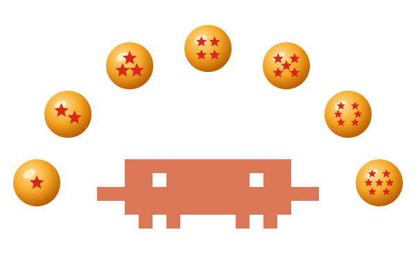
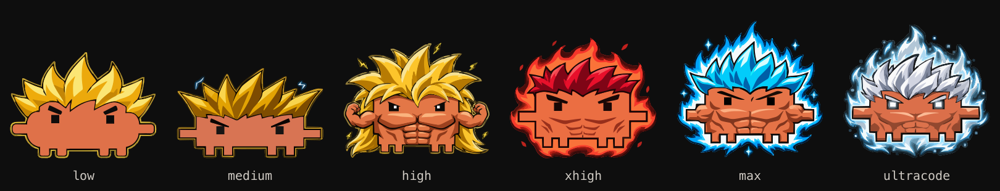

# Claude IDE Dragonball

An IDE-style layout and a black Claude-orange theme for CLI coding agents in iTerm2 on macOS: Claude Code, Codex, Antigravity (agy), Gemini, opencode, aider, Copilot, Cursor.

[Tiếng Việt](README.vi.md)

```
┌──────────────┬──────────────┐
│ agent        │ preview      │
│              │ (iTerm2      │
│              │  browser)    │
└──────────────┴──────────────┘
```

- **Claude IDE Dragonball theme**: black `#0E0E0E`, Claude orange `#D97757`, JetBrains Mono Nerd Font, solid background, unfocused panes dimmed. Set as the default profile, so windows opened by other launchers (CC Switch, etc.) get it too.
- **`ide` command**: opens the preview pane, then starts the agent in the main pane. Plain `ide` only opens the preview, so inside a running agent type `! ide`. The tab takes the agent's colour (iTerm2).
- **`ide` skill** for Claude Code, Codex and agy: say "give me the IDE layout" and the agent runs `ide` itself.

## Requirements

macOS with [iTerm2](https://iterm2.com) (`brew install --cask iterm2`) and `uv`. The preview pane also needs iTerm2's browser plugin: open any Browser-type profile and iTerm2 shows "Browser Plugin Missing" with a download button; without it `ide` still starts the agent, just without the preview. Terminal.app and Windows are not supported.

## Install

```bash
git clone https://github.com/cyrus5x89/claude-ide-dragonball && ./claude-ide-dragonball/install.sh
```

Needs `uv` and the iTerm2 browser plugin (iTerm2 asks to install it the first time a browser pane opens); JetBrains Mono Nerd Font recommended. Claude Code plugin (skill only, no theme or `ide` command):

```
/plugin marketplace add cyrus5x89/claude-ide-dragonball
/plugin install claude-ide-dragonball@claude-ide-dragonball
```

## Preview pane (macOS)

`ide` opens an iTerm2 browser pane on the right as a small file explorer for the current folder (folders first, breadcrumb, back with `..`). Videos, images and audio play inline with seeking, Markdown is rendered, code is highlighted, text is read as UTF-8, HTML and PDF open directly. It is served by `bin/pv-serve`, a tiny local server on 127.0.0.1 with a random token in every URL that shuts itself down after 8 idle hours. Point it elsewhere with `pv <file|url|folder>` (`pv localhost:3000`, `pv render.mp4`, `pv github.com`), close it with `pvx`. 

## Presets

Anything after the preset is passed to the agent, e.g. `ide ccy --model opus` or `ide cx -m gpt-6.1`. Full list: `ide --help`.

| Type | Runs | What it does |
|---|---|---|
| `ide claude` | `claude` | Claude Code, asks before risky actions |
| `ide cc` | `claude` | same as claude |
| `ide ccy` | `claude --dangerously-skip-permissions` | never asks; full trust, use in repos you can reset |
| `ide cca` | `claude --permission-mode auto` | auto mode: a classifier approves safe actions, asks on risky ones |
| `ide cce` | `claude --permission-mode acceptEdits` | auto-accept file edits, still asks for shell commands |
| `ide ccp` | `claude --permission-mode plan` | plan mode: reads and plans, changes nothing until you approve |
| `ide ccc` | `claude --continue` | continue the last conversation in this folder |
| `ide ccr` | `claude --resume` | pick an older conversation to resume |
| `ide ccw` | `claude --worktree` | work in a fresh git worktree, your branch stays clean |
| `ide codex` | `codex` | Codex CLI, default approvals |
| `ide cx` | `codex` | same as codex |
| `ide cxa` | `codex --approve-for-me` | auto-review approvals inside the workspace sandbox |
| `ide cxy` | `codex --dangerously-bypass-approvals-and-sandbox` | no approvals and no sandbox; full trust |
| `ide cxr` | `codex resume --last` | continue the last Codex session |
| `ide agy` | `agy` | Antigravity CLI |
| `ide agyy` | `agy --dangerously-skip-permissions` | Antigravity, auto-approve every tool |
| `ide agyc` | `agy --continue` | continue the last Antigravity conversation |
| `ide gemini` | `gemini` | Gemini CLI |
| `ide opencode` | `opencode` | opencode |
| `ide aider` | `aider` | aider |
| `ide copilot` | `copilot` | GitHub Copilot CLI |
| `ide cursor` | `cursor-agent` | Cursor agent CLI |

**Which permission mode?** Start with `ccp` (plan) to read an unfamiliar repo, `cca` or `cce` for everyday work, and `ccy` / `cxy` / `agyy` only where nothing can hurt you: a fresh worktree (`ccw`), a container, or a repo you can `git reset`. Those three skip every confirmation, including deletes and pushes.

## Effort colours + dragon balls (iTerm2)

`ide-tint <effort>` retints the current iTerm2 pane for the Claude Code effort level and prints a dragon-ball icon (❶ one-star … ❼ seven-star) for the model to use as the model icon in your status line. The background stays black; cursor, tab, selection, links and the yellow/blue/magenta/cyan code colours follow the level, red/green stay put so diffs still read.

Stars on the ball = how smart the model is (Artificial Analysis Intelligence Index, [benchlm.ai](https://benchlm.ai/benchmarks/artificialanalysis), 19 Nov 2026). Unknown models fall back to the effort level (low ❶ … max ❺).

| Ball | Index | Models |
|---|---|---|
| ❼ | ≥ 63 | Claude Fable 5.2 (64.6) |
| ❻ | 60–63 | GPT-6.2 Astra (62.1), Gemini 4 Neon (61.4), Gemini 4 Carbon (60.0) |
| ❺ | 57–60 | Claude Opus 5.5 (59.1), GPT-6.2 Sol (57.3) |
| ❹ | 53–57 | GPT-6.1 Sol (54.6), Claude Sonnet 5.5 (54.5), Gemini 4 Hydrogen (53.9) |
| ❸ | 48–53 | Gemini 4 Argon (50.4), Claude Fable 5 (49.6), Claude Fable 5.1 (49.2) |
| ❷ | 40–48 | – |
| ❶ | < 40 | Claude Haiku 5.5 (36.5) |

The colour follows the effort level:

| Effort | Accent |
|---|---|
| low | gold `#F2C230` |
| medium | deep gold `#C98A0B` |
| high | bright gold `#FFD84D` |
| xhigh | crimson `#E0384F` |
| max | blue `#2FA8F0` |
| ultracode | silver `#D8DEE9` (your last prompt contains "ultracode") |

Call it from your status line script with the effort from the status line JSON (`effort.level`) and the transcript path:

```python
out = subprocess.run(["ide-tint", effort, "--model", data["model"]["id"], "--transcript", data["transcript_path"]], capture_output=True, text=True, timeout=1).stdout
```

It only talks to iTerm2 when the level changes.

- **agy**: call `ide-tint <effort>` the same way from `~/.gemini/antigravity-cli/statusline.py` (agy passes `model.effort`) and use the output as the model icon.
- **Codex**: its status line takes only built-in items, so there is no icon, but the pane still retints. Add `ide-tint --hook` as a `SessionStart` and `UserPromptSubmit` command hook in `~/.codex/hooks.json`; it reads the effort of the latest turn from the rollout (fallback `model_reasoning_effort` in `config.toml`) and prints nothing. The profile also carries a faint Claude + dragon balls watermark in the bottom-right corner (`art/dragonball/watermark.png`, drawn by `make.py`).



## Effort mascots

Claude Code's mascot powering up per effort level (`art/saiyan/`, SVG + PNG, 18x18 grid, shared baseline):



Regenerate: `art/saiyan/gen.sh [level...]` (needs the `studio image` CLI), then `uv run --python 3.12 --with vtracer --with pillow python art/saiyan/vectorize.py`.

## Customise

Edit the `AGENTS` table at the top of `bin/ide`: `name: (command, tab colour, English note, Vietnamese note)`. `PV_WIDTH=0.5 ide` changes the preview width (default 0.4).
