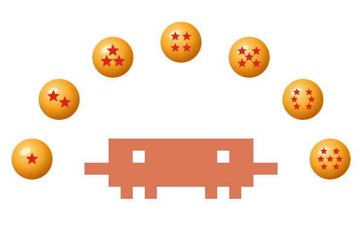
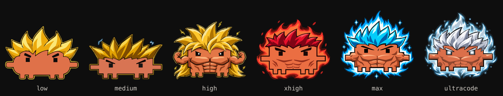

# Claude IDE Dragonball

Bố cục kiểu IDE và theme đen nhấn cam Claude cho các CLI agent trên iTerm2 (macOS) và Windows Terminal: Claude Code, Codex, Antigravity (agy), Gemini, opencode, aider, Copilot, Cursor.

[English](README.md)

```
┌──────────────┬──────────────┐
│ agent        │ preview      │
│              │ (iTerm2      │
│              │  browser)    │
└──────────────┴──────────────┘
```

- **Theme Claude IDE Dragonball**: nền đen `#0E0E0E`, cam Claude `#D97757`, font JetBrains Mono Nerd, nền đặc, khung không dùng thì tối đi. Đặt làm profile mặc định nên cửa sổ do CC Switch hay app khác mở cũng có theme.
- **Lệnh `ide`**: mở khung preview rồi chạy agent ở khung chính. Gõ `ide` không kèm gì thì chỉ mở preview, nên trong agent đang chạy gõ `! ide`. Tab đổi màu theo agent (iTerm2).
- **Skill `ide`** cho Claude Code, Codex, agy: nói "chia khung IDE" là agent tự chạy `ide`.

## Cài

```bash
git clone https://github.com/cyrus5x89/claude-ide-dragonball && ./claude-ide-dragonball/install.sh   # macOS
pwsh ./claude-ide-dragonball/install.ps1                                                  # Windows
```

Cần `uv` và plugin trình duyệt của iTerm2 (lần đầu mở khung trình duyệt iTerm2 sẽ hỏi cài); nên có font JetBrains Mono Nerd. Plugin Claude Code (chỉ có skill, không có theme và lệnh `ide`):

```
/plugin marketplace add cyrus5x89/claude-ide-dragonball
/plugin install claude-ide-dragonball@claude-ide-dragonball
```

## Khung preview (macOS)

`ide` mở khung trình duyệt của iTerm2 bên phải, liệt kê file trong thư mục đang đứng (sâu 3 cấp). Bấm video, ảnh, nhạc là phát ngay phía trên; HTML, PDF, Markdown, JSON thì mở thẳng. Đổi nội dung bằng `pv <file|url|thư mục>` (`pv localhost:3000`, `pv render.mp4`, `pv github.com`), đóng bằng `pvx`. Windows Terminal không có khung trình duyệt nên ở đó `ide` chỉ chạy agent.

## Lệnh có sẵn

Gõ thêm gì sau tên lệnh thì được chuyển thẳng cho agent, ví dụ `ide ccy --model opus` hay `ide cx -m gpt-6.1`. Xem hết: `ide --help vi`.

| Gõ | Chạy | Làm gì |
|---|---|---|
| `ide claude` | `claude` | Claude Code, hỏi trước khi làm việc rủi ro |
| `ide cc` | `claude` | giống claude |
| `ide ccy` | `claude --dangerously-skip-permissions` | không hỏi gì cả; chỉ dùng ở repo khôi phục được |
| `ide cca` | `claude --permission-mode auto` | tự duyệt việc an toàn, vẫn hỏi việc nguy hiểm |
| `ide cce` | `claude --permission-mode acceptEdits` | tự nhận sửa file, lệnh shell vẫn hỏi |
| `ide ccp` | `claude --permission-mode plan` | chỉ đọc và lên kế hoạch, duyệt rồi mới sửa |
| `ide ccc` | `claude --continue` | tiếp cuộc trò chuyện gần nhất ở thư mục này |
| `ide ccr` | `claude --resume` | chọn cuộc trò chuyện cũ để mở lại |
| `ide ccw` | `claude --worktree` | làm trong git worktree mới, nhánh đang dùng không bị đụng |
| `ide codex` | `codex` | Codex CLI, duyệt mặc định |
| `ide cx` | `codex` | giống codex |
| `ide cxa` | `codex --approve-for-me` | tự duyệt trong sandbox của thư mục làm việc |
| `ide cxy` | `codex --dangerously-bypass-approvals-and-sandbox` | không hỏi, không sandbox; tin hoàn toàn |
| `ide cxr` | `codex resume --last` | tiếp phiên Codex gần nhất |
| `ide agy` | `agy` | Antigravity CLI |
| `ide agyy` | `agy --dangerously-skip-permissions` | Antigravity, tự duyệt mọi công cụ |
| `ide agyc` | `agy --continue` | tiếp cuộc trò chuyện agy gần nhất |
| `ide gemini` | `gemini` | Gemini CLI |
| `ide opencode` | `opencode` | opencode |
| `ide aider` | `aider` | aider |
| `ide copilot` | `copilot` | GitHub Copilot CLI |
| `ide cursor` | `cursor-agent` | Cursor agent CLI |

**Chọn chế độ quyền nào?** Repo lạ thì mở `ccp` (chỉ lên kế hoạch) để đọc trước. Làm việc hằng ngày thì `cca` hoặc `cce`. `ccy` / `cxy` / `agyy` chỉ dùng ở chỗ hỏng cũng không sao: worktree mới (`ccw`), container, hoặc repo `git reset` lại được. Ba lệnh này bỏ qua mọi bước xác nhận, kể cả xoá file và push.

## Màu theo effort + ngọc rồng (iTerm2)

`ide-tint <effort>` đổi màu khung iTerm2 đang đứng theo mức effort của Claude Code và in icon ngọc rồng (❶ 1 sao … ❼ 7 sao) làm icon model trên status line. Nền vẫn đen; con trỏ, tab, vùng chọn, link và các màu vàng/xanh/tím/lục lam trong code đổi theo cấp, đỏ/xanh lá giữ nguyên để diff vẫn đọc được.

| Effort | Ngọc | Màu nhấn |
|---|---|---|
| low | ❶ | vàng `#F2C230` |
| medium | ❷ | vàng sẫm `#C98A0B` |
| high | ❸ | vàng sáng `#FFD84D` |
| xhigh | ❹ | đỏ `#E0384F` |
| max | ❺ | xanh `#2FA8F0` |
| ultracode | ❼ | bạc `#D8DEE9` (prompt gần nhất có chữ "ultracode") |

Gọi từ script status line, truyền effort lấy từ JSON của status line (`effort.level`) và đường dẫn transcript:

```python
out = subprocess.run(["ide-tint", effort, "--transcript", data["transcript_path"]], capture_output=True, text=True, timeout=1).stdout
```

Nó chỉ gọi iTerm2 khi mức effort đổi.

- **agy**: gọi `ide-tint <effort>` y như vậy trong `~/.gemini/antigravity-cli/statusline.py` (agy có sẵn `model.effort`) rồi dùng kết quả làm icon model.
- **Codex**: status line chỉ nhận mục có sẵn nên không gắn được icon, nhưng khung vẫn đổi màu. Thêm `ide-tint --hook` làm hook `SessionStart` và `UserPromptSubmit` trong `~/.codex/hooks.json`; nó đọc effort của lượt gần nhất trong rollout (không có thì lấy `model_reasoning_effort` trong `config.toml`) và không in gì. Profile còn có hình mờ Claude + ngọc rồng ở góc dưới phải (`art/dragonball/watermark.png`, vẽ bằng `make.py`).



## Mascot theo mức effort

Mascot Claude Code biến hình theo từng mức effort (`art/saiyan/`, SVG + PNG, đo trên lưới 18x18, chung đường đáy):



Tạo lại: `art/saiyan/gen.sh [cấp...]` (cần lệnh `studio image`), rồi `uv run --python 3.12 --with vtracer --with pillow python art/saiyan/vectorize.py`.

## Tuỳ chỉnh

Sửa bảng `AGENTS` đầu file `bin/ide`: `tên: (lệnh, màu tab, ghi chú tiếng Anh, ghi chú tiếng Việt)`. `PV_WIDTH=0.5 ide` đổi độ rộng khung preview (mặc định 0.4).
